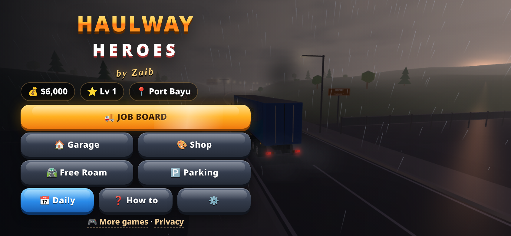
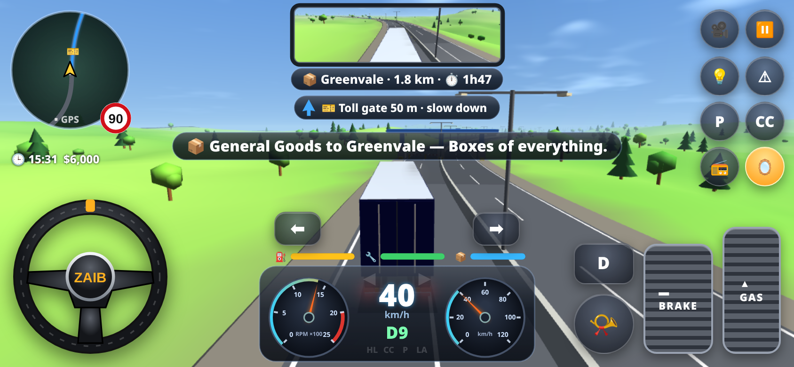
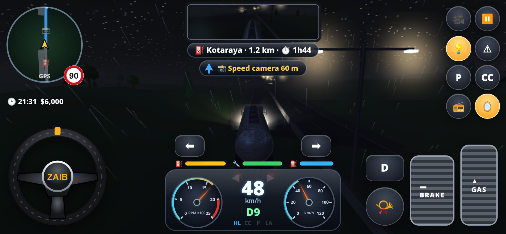
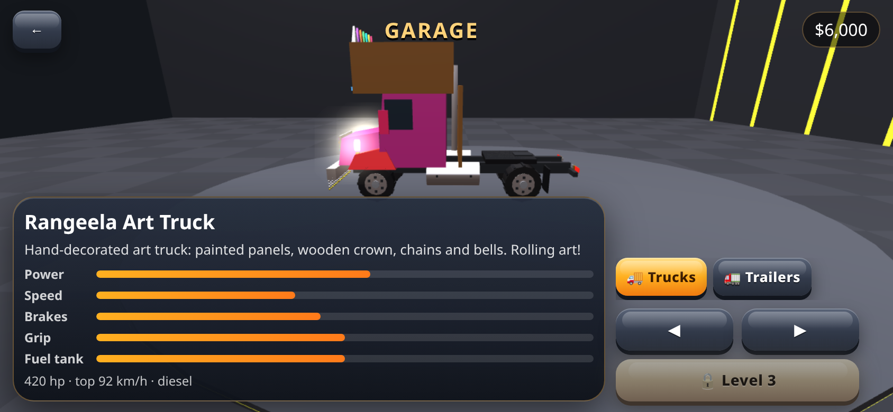

# Haulway Heroes by Zaib

A premium 3D truck-driving career game for mobile browsers. It is written in hand-made WebGL with no libraries and ships as a single `index.html` file.

**Play:** https://zaibgames.com/haulway-heroes/

## Features
- **3D world:** real-time 3D trucks with an articulated trailer. The physics include off-tracking, jackknifing and air brakes.
- **Terrains:** highways, cities with traffic lights, mountain hairpins, desert, snowy passes, and rainy or foggy nights.
- **Day and night:** a full day/night cycle with headlights. Rain comes with working wipers, plus fog and snow.
- **Traffic:** AI traffic in both directions and an escort vehicle for oversized loads.
- **Stops along the route:** gas/charge stations, weigh stations, toll gates, speed cameras and depots.
- **Contracts:** general goods, electronics, fragile glass, livestock, fuel, logs, cars and oversized loads.
- **Reverse docking:** back into the loading bay yourself, or let the assist park for you (with a reduced bonus).
- **Ratings and pay:** you are rated on time, damage, comfort and violations, and paid for each delivery.
- **Career:** 6 trucks, including the Rangeela art truck, and several trailers. Earn XP and levels, and move between cities on the map.
- **Garage and shop:** upgrades, paints, decals, lights and horns.
- **Game modes:** free roam, a daily challenge, 8 parking challenges, and a guided tutorial delivery.
- **Audio:** synthesized engine, air brakes, horn, rain and radio.
- **Saving:** progress is saved in localStorage.

## Controls
- **Steering:** drag the on-screen wheel, tilt your phone, or use the ◀ ▶ buttons (choose in Settings).
- **Pedals:** GAS and BRAKE. The D/R button switches between drive and reverse.
- **Gearbox:** automatic or manual (manual adds + and − buttons).
- **Other buttons:** horn, indicators, lights, hazards, handbrake (P), cruise control (CC), radio and mirror. Use 🎥 to cycle between chase and cab cameras.
- **Keyboard:** arrows/WASD to drive, Space for the handbrake, H for the horn, C for the camera, R to reverse, Q/E for the indicators, L for the lights.

Game by Zaib · [More games](https://zaibgames.com/) · [Privacy](https://zaibgames.com/privacy/)
